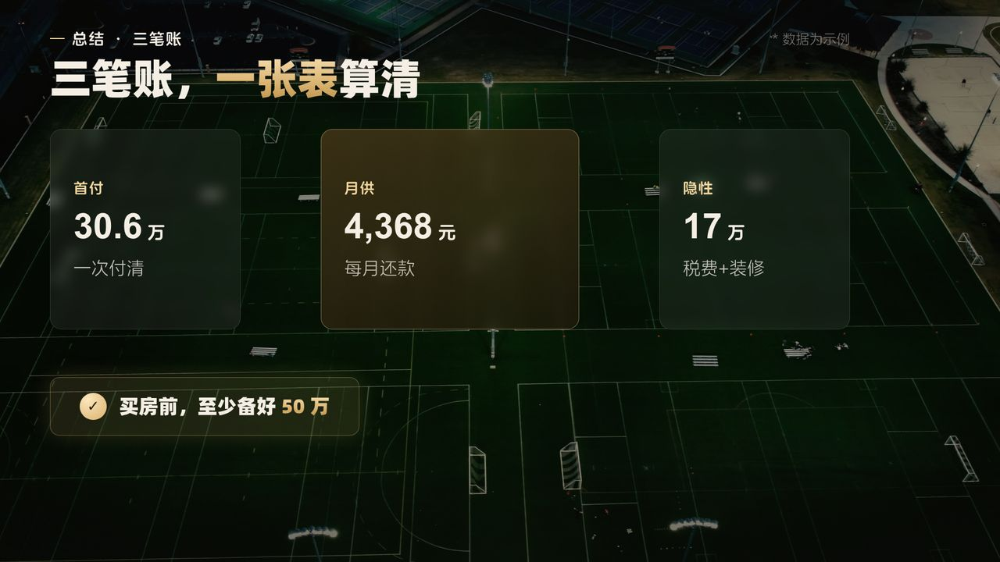

# 小滕分镜风格 4.5 版本

用 Remotion 做 1920×1080 知识科普分镜视频的模板和 Skill。整体是深色电影感背景、暖金点缀、轻量 MG，自带排版检查和防顿帧处理，可在 Windows 和 macOS 上使用。

**音画同步**：给它口播音频和带时间码的字幕（SRT / Remotion Caption JSON），镜头会在对应的句子开始时切换，数字和要点在说到时到位，成片自带声音和精致的烧录字幕（磨砂浅底、42px、当前词沙金高亮）。


| | |
|---|---|
|  |  |
|  |  |
|  |  |
|  |  |
|  |  |

## 安装
需要 Node ≥ 22.18。
```bash
git clone https://github.com/pensongchs/storyboard-visual-style-template-4.5.git
cd storyboard-visual-style-template-4.5/template
npm run setup      # 优先复用已有依赖（环境变量 XT_SHARED_NODE_MODULES / 父目录 / 同级模板），没有才 npm install；同时下载视频素材
npm run stock:verify  # 校验视频素材（≥1080p、时长、不重复、已登记）
npm run episode -- demo  # 读取 episodes/demo/ 的音频和字幕
npm run check      # 排版检查
npm run stills     # 输出定格图和联系表
npm run render     # 输出带声音和字幕的 out/成片.mp4（--no-subs 不烧字幕，--no-highlight 不高亮）
```
作为 Skill 使用时，把整个仓库放进你的 skills 目录（例如 `~/.codex/skills/小滕分镜风格4.5版本`），然后对 Codex 说「用小滕分镜风格4.5版本做这期视频」。

## 每期怎么做
1. 把口播音频和时间码字幕放进 `template/episodes/<期名>/`，跑 `npm run episode -- <期名>`。语音识别的字幕要先校对文字（不改时间码）。
2. 在 `src/demo/shots.ts` 里给每个镜头写 `at: {cue: 第几句}` 和动效锚点 `anchors`，不用写秒数。
3. `npm run check` → `npm run stills` → `npm run render`。
详见 [音画同步与字幕](references/音画同步与字幕.md)。


## 每期素材怎么来
- **视频**：每期由 Codex 上网找 ≥1080p 的中国城市航拍（优先白天、优先学员所在城市，可免费商用，没有水印），下载后用 `npm run stock:verify` 校验。仓库自带的 `npm run stock` 只是演示素材。
- **概念图**：由 Codex 调用生图模型生成，一期 3–6 张，要求写实、明亮、暖色、中国住宅场景、画面里没有任何文字。
- 详细规则见 [素材与生图规则](references/素材与生图规则.md)。

## 复用依赖
如果你已经装过其他小滕模板，只要它们的 `node_modules` 里 remotion 4.0.484 和 react 19.2.7 的版本一致，`setup` 就会直接链接复用（Windows 用 junction，macOS 用符号链接），不会重新下载。也可以手动指定：
```bash
# macOS
XT_SHARED_NODE_MODULES=/path/to/node_modules npm run setup
# Windows PowerShell
$env:XT_SHARED_NODE_MODULES="D:\模板\node_modules"; npm run setup
```

## 文档
- [SKILL.md](SKILL.md)：工作流程和设计思路
- [音画同步与字幕](references/音画同步与字幕.md) · [风格设计规范](references/风格设计规范.md) · [素材与生图规则](references/素材与生图规则.md) · [版式目录](references/版式目录.md) · [组件 API](references/组件API.md)
- [素材来源](template/public/media/stock/SOURCES.md) · [第三方资源说明](NOTICE.md)
